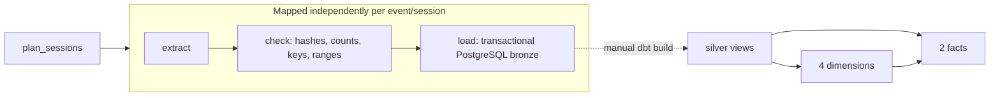

# F1 Analytics Data Platform

**Data Engineering Project — Group 26**
University of Tartu, III Semester

An analytical data platform that evaluates the impact of qualifying performance on race outcomes and tracks constructor performance across the 2025 and 2026 Formula 1 seasons.

For the full project proposal, including the detailed data architecture, data model, and data dictionary, see [`Reports/Project_long_version.md`](Reports/Project_long_version.md).

---

## Team Members

- Ahto Kiil
- Dagmar Läänemets
- Georg Allikas
- Kerttu Tilk
- Teemu-Oliver Soorm

---

## Project Goal

To build an analytical data platform that analyzes the relationship between qualifying performance, race outcomes, weather conditions, and constructor performance across the 2025 and 2026 Formula 1 seasons.

**Stakeholders:** F1 race team strategy analysts, sports media, fans

Weather enrichment is planned. The implemented datasets support the six timing/result
questions below; weather data has not been ingested.

---

## Business Questions

1. How frequently does the pole position (P1) qualifier win the race?
2. Which teams gained or lost the most net positions across the season?
3. Which individual drivers gained or lost the most positions across the season?
4. How many times (and at which circuits) has the pole position driver maintained the lead at the end of lap 1?
5. What is the head-to-head qualifying position gap between teammates, and does it translate into final race results?
6. What is the largest qualifying time gap (and position) to pole from which a driver still managed to win the race?

---

## Key Metrics

| Metric | Description |
|---|---|
| **Position Change Delta** (Net Positions Gained/Lost) | Difference between starting grid position and final finishing position. |
| **Qualifying Gap to Pole** (Time Delta) | The gap (in seconds) between a driver's qualifying time and the P1 pole position time. |
| **Lap 1 Leader Retention Rate** | Percentage of races where the pole sitter (P1) maintains the lead at the end of Lap 1. |

---

## Data Sources

The active pipeline uses [OpenF1's public historical API](https://openf1.org/docs/),
covering 2025 and completed 2026 sessions. Historical access is free without an account.
OpenF1 replaced the original proposal's FastF1 source after F1 restricted archive access.

| Dataset | OpenF1 endpoint | Description |
|---|---|---|
| **Lap Timing** | OpenF1 `laps`, plus `position` | Lap timing and approximate as-of race positions; track status is currently null. |
| **Session Results & Qualifying Summary** | OpenF1 `session_result`, `starting_grid`, `drivers` | Main Q/R classifications, Q1/Q2/Q3 times, race points and available grid positions. |

---

## Architecture Overview

```
OpenF1 historical API → Airflow → Raw Landing (Docker volume, JSON)
           → PostgreSQL bronze → dbt silver views → dbt gold star schema
           → SQL queries (dashboards planned)
```

1. **Data Source:** Public OpenF1 HTTP API; ingestion currently uses historical laps, results and supporting metadata.
2. **Ingestion:** Parameterized Python extraction through an Airflow DAG. Historical backfills are triggered explicitly; the paused weekly schedule currently uses a 2025 round-1 example.
3. **Raw Landing Storage:** Extracted payloads are persisted as JSON files in persistent Docker volumes.
4. **Loading & Transformation (ELT):** Validated source records are loaded into PostgreSQL bronze; a separate dbt build creates silver views and the gold star schema.
5. **Data Quality:** Ingestion validates identities, duplicates, ranges and checksums; PostgreSQL constraints and dbt tests verify keys, relationships and fact grains.
6. **Reporting / Serving:** Direct SQL queries run against gold. Superset / Streamlit dashboards are planned; business-rule validation of the draft queries remains in 2.3.

**Planned update frequency:** After race weekends. Available 2025 data and completed 2026 weekends through the 22 October cutoff are loaded. New-weekend selection and automatic Airflow-to-dbt execution remain to be implemented.

---

## Tooling

| Category | Tools |
|---|---|
| Infrastructure & Containerization | Docker |
| Data Ingestion | Python standard library (OpenF1 HTTP API), Apache Airflow |
| Data Storage (Landing) | Docker volumes |
| Transformation & Modeling | dbt, ER Diagrams / Star Schema design |
| Data Warehouse | PostgreSQL |
| Governance & Metadata | OpenMetadata (planned) |
| Reporting & Analytics | Direct SQL; Apache Superset / Streamlit (planned) |

---

## Data Model

The warehouse implements a multi-fact star schema with two fact tables (`FactLap`, `FactDriverEventResult`) and four dimensions (`DimDriver`, `DimTeam`, `DimDriverTeamAssignment`, `DimEvent`).

See the full schema, SCD strategy, and data dictionary in [`Reports/Project_long_version.md`](Reports/Project_long_version.md#5-data-model).

The [`SQL/`](SQL) folder contains:
- `create_schema.sql` — DDL for the full star schema (dimensions + fact tables).
- `sample_data.sql` — Small, hand-crafted sample rows for every table. **This is illustrative/test data only** — it does not come from the OpenF1 API or the real ingestion pipeline. It exists to (1) validate that `create_schema.sql` runs cleanly, and (2) provide known inputs to test-run and verify the logic of the analytical queries below without needing a working end-to-end pipeline.
- `query_01` – `query_06` — Draft analytical queries for the six business questions. They execute against gold; season grouping, teammate pairing and metric eligibility need refinement in 2.3. See [README_Phase2](README_Phase2.md).

---

## Project 1 Repository Structure

```
.
├── README.md
├── Reports/
│   └── Project_long_version.md          # Full project proposal
└── SQL/
    ├── create_schema.sql                 # Star schema DDL
    ├── sample_data.sql                   # Illustrative sample rows (not pipeline output)
    ├── query_01_pole_wins.sql
    ├── query_02_team_position_change.sql
    ├── query_03_driver_position_change.sql
    ├── query_04_lap1_leader.sql
    ├── query_05_teammate_comparison.sql
    └── query_06_biggest_gap_win.sql
```

---

## Project 2 implementation: sections 2.1 and 2.2

Airflow ingests OpenF1 lap timing and session results into PostgreSQL. Bronze preserves raw API responses, adapted compatibility
records and provenance, silver contains typed dbt views, and gold contains the
four dimensions and two fact tables from Project 1. The ingestion DAG ends at
bronze; run dbt separately to build gold. Airflow-to-dbt automation in section 2.4
is a later integration task.

See [storage design and verification](docs/ingestion_storage.md) for the PostgreSQL
justification and failure/recovery rules, and [the data contract](docs/data_contract.md)
for fields, grains, units and null rules.

### Setup

Install Docker Desktop with Linux containers (or Docker Engine with Compose v2).
Allow roughly 4 GB of Docker memory. In Ubuntu WSL, enable Docker Desktop
integration for Ubuntu so the Docker CLI can reach the engine. Source code is
copied into images and needs no project bind mounts. See [START](START.md) for
startup, credentials, dated backfills and database inspection.

Copy the configuration once: `cp .env.example .env` in Linux/WSL, or
`Copy-Item .env.example .env` in PowerShell. Edit the local passwords and secret
key before first startup; keep the Airflow database password URL-safe. Existing
database volumes retain their original credentials.

```sh
docker compose --profile tools build
docker compose up -d
docker compose ps
```

Initialization creates the warehouse schemas, migrates the separate Airflow
metadata database and creates the admin user. Wait for the webserver and scheduler
to become healthy. Open [Airflow](http://localhost:8080) and log in with the
AIRFLOW_ADMIN_USER/AIRFLOW_ADMIN_PASSWORD values in .env. PostgreSQL is available
at localhost:5433 with the POSTGRES_* credentials. The DAG starts paused.

### Ingest one event

Run the complete DAG directly, including its mapped Q/R tasks:

```sh
docker compose run --rm pipeline scripts/smoke_dag.py --season 2025 --rounds 1 --sessions Q R --cutoff 2025-03-18
```

Alternatively, trigger `f1_ingestion` from the Airflow UI with this configuration:

```json
{"season": 2025, "rounds": [1], "sessions": ["Q", "R"], "cutoff": "2025-03-18"}
```

Cutoff is an exclusive UTC date. Use the same command/configuration to rerun:
identical inputs are skipped; corrected source records replace the selected
session atomically. Each session loads both datasets. Missing/unavailable sources
fail and retry without erasing earlier data.

List the OpenF1 calendar mapping before choosing rounds:

```sh
docker compose run --rm pipeline -m ingestion.cli schedule --season 2025
```

For recovery in Ubuntu Bash, reuse validated files and explicitly retain
available classifications when a lap source is missing:

```bash
docker compose run --rm pipeline scripts/smoke_dag.py \
  --season 2025 --rounds {1..24} --sessions Q R --cutoff 2026-01-01 \
  --reuse-landed --allow-missing-laps
```

Missing laps are flagged as unavailable, never synthesized. Omit
`--reuse-landed` to refresh API data. Without `--allow-missing-laps`, missing
required laps fail that session; other sessions can still load independently.

For a historical backfill, supply multiple rounds, for example
`--season 2025 --rounds 1 2 3 --cutoff 2026-01-01`. Continue with the actual rounds
from that calendar mapping. For 2026, include only completed rounds before the
chosen cutoff; do not represent the season as complete. The Tuesday 06:00 UTC
schedule uses the defaults in the DAG (currently the small 2025 round-1 example).
Change those defaults before unpausing a different recurring coverage.

### Build the analytical storage

```sh
docker compose run --rm dbt build
docker compose exec warehouse psql -U f1 -d f1_warehouse
```

In psql, use `SET search_path TO gold, public;` before running the Project 1 SQL
queries. Substitute your configured user/database if you changed them. The gold
tables use deterministic text keys, numeric points, and indexed fact grains.
Bronze refreshes incrementally by session; gold currently rebuilds from all
available bronze data, which correctly propagates corrected and removed records.

The original `SQL/create_schema.sql` and `SQL/sample_data.sql` remain the Project 1
illustration. They are not run against the implemented warehouse; dbt owns gold.



### Verify without network access

The tests use a newly created temporary PostgreSQL database and labelled synthetic
fixtures. They do not insert fixture rows into the warehouse.

```sh
docker compose run --rm -e F1_TEST_POSTGRES=1 pipeline -m unittest discover -s tests -v
```

To run the full mapped DAG twice and build gold using fixtures, create a **new**
test database, then run dbt against it:

```sh
docker compose run --rm pipeline scripts/prepare_fixture_database.py --database f1_storage_test
docker compose run --rm -e PGDATABASE=f1_storage_test dbt build
docker compose run --rm -e PGDATABASE=f1_storage_test pipeline scripts/check_fixture_gold.py
```

The preparation script refuses an existing database. After inspection, remove only
that test database:

```sh
docker compose exec warehouse dropdb -U f1 f1_storage_test
```

Verified on 24 October 2026: 46 Python tests pass, including PostgreSQL rollback,
concurrency, independent session loads, resume and idempotency checks. The available
2025 Q/R data is loaded for all 24 rounds, and 2026 is loaded through the 17
completed weekends ending at Singapore on 11 October (cutoff 22 October 2026).
Azerbaijan 2025 qualifying laps are missing; 2026 Australia and Spain round 14
qualifying have missing driver classifications. These are explicitly flagged.
Observed lap participants retain null result metrics when classification is absent.
All 82 stored session bundles replayed unchanged, including audit timestamps.
The dbt build passed 8 models and 27 tests. All six SQL scripts execute; their
business-rule gaps are listed in [README_Phase2](README_Phase2.md), alongside
source counts, coverage and the steps remaining for 2.3.

The [data contract](docs/data_contract.md) records OpenF1-specific limitations:
lap positions are approximate as-of observations; driver/team IDs are name-derived;
missing grid positions, points and track status are not guessed. Original response
arrays remain in `bronze.source_responses`. The original proposal in Reports retains
its original FastF1 description as project history.

### Development and replay

Rebuild images after source changes:
`docker compose --profile tools build`, then `docker compose up -d`.
Data, landing files, request state and logs persist in named volumes.
Use `docker compose down` to stop without deleting those volumes.

The CLI can extract, validate and replay a single session independently:

```sh
docker compose run --rm pipeline -m ingestion.cli extract --season 2025 --round 1 --session R --cutoff 2025-03-18
docker compose run --rm pipeline -m ingestion.cli check /opt/airflow/data/2025/1/R/ATTEMPT/manifest.json
docker compose run --rm pipeline -m ingestion.cli load /opt/airflow/data/2025/1/R/ATTEMPT/manifest.json
```

Replace ATTEMPT with the directory printed by extraction. Use
`docker compose run --rm pipeline -m ingestion.cli init-db` to reapply the additive
bronze DDL to an existing volume.

The implementation lives in `compose.yaml`, `docker/`, `dags/`, `ingestion/`,
`SQL/bronze_setup.sql`, `dbt/`, `scripts/` and `tests/`.
